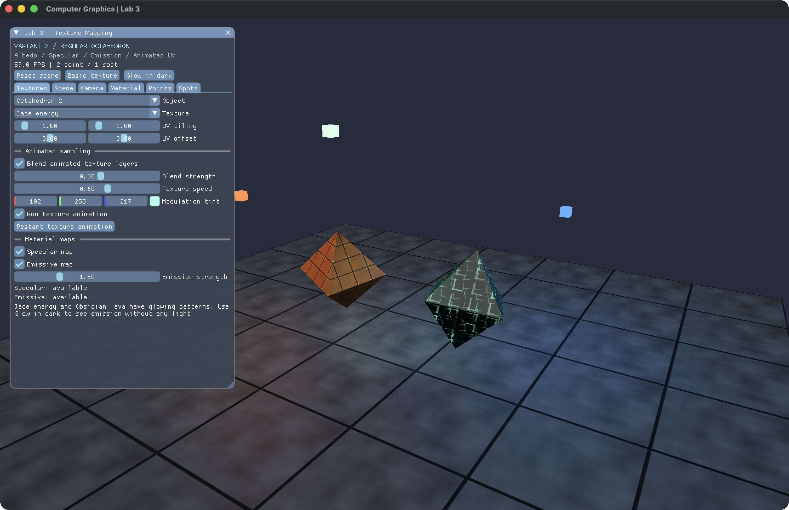

# Лабораторные работы по компьютерной графике

Vulkan, GLFW, Dear ImGui, C++20. **Вариант 2 — правильный октаэдр.**
Основа проекта: [vladeemerr/vulkan-starter-app](https://github.com/vladeemerr/vulkan-starter-app).

| Работа | Содержание | Документация |
| --- | --- | --- |
| №1 | Два октаэдра, проекции, преобразования и анимация | [labs/lab1](labs/lab1/README.md) |
| №2 | Камера, материалы Блинна–Фонга, направленный свет, динамические массивы точечных источников и прожекторов, визуализация источников | [labs/lab2](labs/lab2/README.md) |
| №3 | Текстуры альбедо, specular/emissive, анимированное сэмплирование, динамический UBO и геометрия в памяти GPU | [labs/lab3](labs/lab3/README.md) |



## Сборка на macOS

Нужны CMake, Ninja, компилятор C++20 и [Vulkan SDK](https://vulkan.lunarg.com/sdk/home) с MoltenVK и `glslc`.
Команды выполняются из корня этого репозитория:

```bash
brew install cmake ninja
source "$HOME/VulkanSDK/1.4.321.0/setup-env.sh" # укажите установленную версию SDK
cmake --preset debug
cmake --build build-debug --parallel
./build-debug/lab3
```

Локальная общая папка называется `computer_graphics`. При новом клонировании:

```bash
git clone https://github.com/MyshakinMikhail/computer-graphics-labs.git computer_graphics
cd computer_graphics
```

Первая конфигурация скачивает зависимости с GitHub. Шейдеры автоматически компилируются в `build-debug/shaders/lab1`, `lab2`, `lab3`. Пути к шейдерам и текстурам задаются при сборке: запускать программы можно из любой рабочей директории. При переносе репозитория в другую папку пересоздайте каталог сборки.

Все три лабораторные собираются независимо:

```bash
cmake --build build-debug --target lab1 --parallel
./build-debug/lab1
cmake --build build-debug --target lab2 --parallel
./build-debug/lab2
cmake --build build-debug --target lab3 --parallel
./build-debug/lab3
```

На Linux и Windows используется тот же CMake-проект. Установите Vulkan SDK и платформенные зависимости GLFW; доступны также пресеты `release`, `msvc-debug`, `msvc-release`, `mingw-debug`, `mingw-release`. Выполнявшаяся здесь проверка графики — macOS/MoltenVK.

## Структура

```text
common/                 # GLFW/ImGui main loop и общий Vulkan backend
labs/lab1/source/       # исходная лабораторная №1
labs/lab1/shaders/
labs/lab2/source/       # камера, геометрия, состояние сцены, интерфейс, renderer
labs/lab2/shaders/      # освещение и отдельная отрисовка обозначений источников
labs/lab2/tests/        # проверки геометрии, камеры, математики и GPU layout
labs/lab3/source/       # загрузка текстур, dynamic UBO, device-local геометрия
labs/lab3/shaders/      # карты материалов и анимированное сэмплирование
labs/lab3/textures/     # PNG материалов и чёрный fallback 1×1
labs/lab3/tools/        # воспроизводимый генератор PNG на Python
labs/lab3/tests/        # индексы/UV, декодирование изображений и GPU contracts
third_party/stb/       # stb_image с исходной лицензией
```

Каждая лабораторная имеет свою исполняемую цель, шейдеры, README и настройки ImGui. Общий код запуска используется всеми тремя работами.

## Проверка

```bash
ctest --test-dir build-debug --output-on-failure
./build-debug/lab1 --frames 15
./build-debug/lab2 --exercise
./build-debug/lab3 --exercise
```

`--exercise` автоматически завершает работу после 110 кадров. Проверяет пустые массивы, рост обоих storage-буферов до 37 источников, удаление источников, равные углы прожектора, нулевые направления, неравномерный масштаб, анимацию и изменение размера окна. `--frames N` ограничивает длительность обычного запуска.

Для проверки синхронизации с установленным validation layer:

```bash
VK_LAYER_ENABLES=VK_VALIDATION_FEATURE_ENABLE_SYNCHRONIZATION_VALIDATION_EXT ./build-debug/lab2 --exercise
```

Ошибки Vulkan validation выводятся в консоль и приводят к ненулевому коду завершения. Подробный сценарий проверки и соответствие заданию — в [README второй лабораторной](labs/lab2/README.md).

Третья лабораторная также поддерживает `--frames N` и `--exercise`. Проверка проходит по всем материалам, общим дескрипторам при разных dynamic offsets, анимированным UV, specular/emissive, чёрным fallback-картам, динамической геометрии конусов и изменению размера окна. Описание и сценарий защиты — в [README третьей лабораторной](labs/lab3/README.md).
