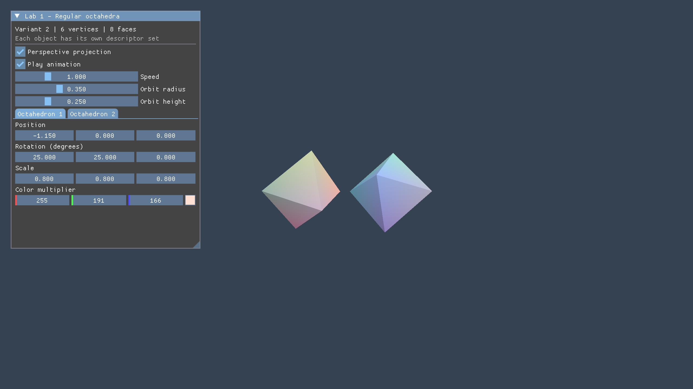
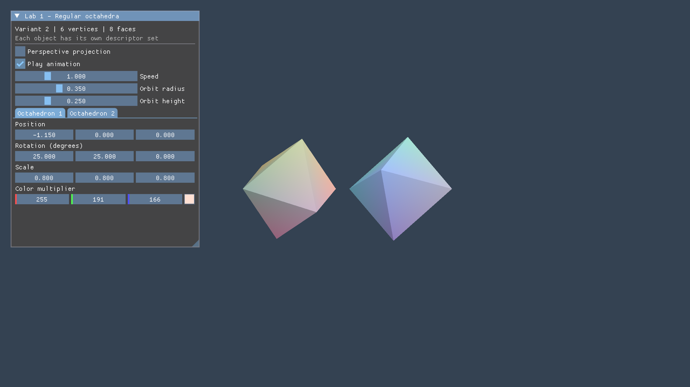

# Лабораторная работа №1

**Вариант 2 — правильный октаэдр.** Два экземпляра фигуры, каждый со своими преобразованиями, uniform-буфером и набором дескрипторов.



## Запуск

Из корня репозитория, после настройки Vulkan SDK:

```bash
cmake --preset debug
cmake --build build-debug --target lab1 --parallel
./build-debug/lab1
```

Общая инструкция по зависимостям: [корневой README](../../README.md).

## Возможности и проверка

- Шесть геометрических вершин, восемь правильных треугольных граней; процедурно вычисленные плоские нормали.
- `Perspective projection` переключает перспективную и ортографическую проекции.
- `Play animation`, `Speed`, `Orbit radius`, `Orbit height` управляют движением.
- Вкладки `Octahedron 1` и `Octahedron 2` независимо задают положение, поворот, масштаб и множитель цвета.
- Цвета вершин вычисляются из локальных координат.
- При изменении размера окна сохраняется корректное соотношение сторон.



Код приложения находится в `source/application.cpp`, шейдеры — в `shaders`. Общий Vulkan backend и точка входа находятся в `../../common`. Скомпилированные шейдеры создаются в каталоге сборки.

Короткая проверка запуска:

```bash
./build-debug/lab1 --frames 15
```
