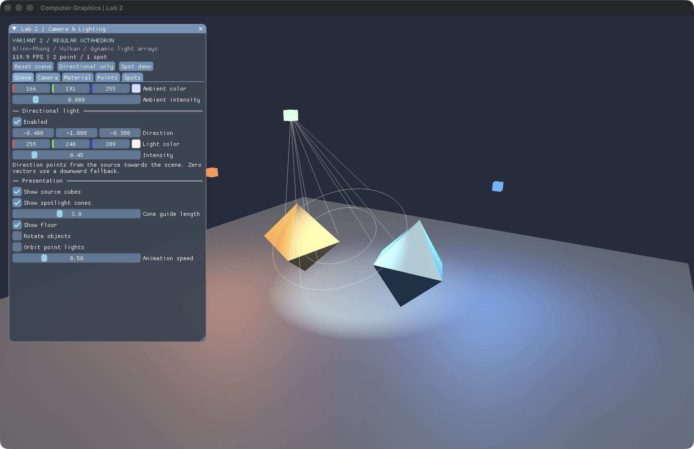

# Лабораторная работа №2: камера и освещение

**Вариант 2 — правильный октаэдр.** Реализованы базовое задание и все четыре дополнительных задания, включая визуализацию источников для оценки 5.



## Сборка и запуск

Из корня репозитория:

```bash
source "$HOME/VulkanSDK/1.4.321.0/setup-env.sh" # укажите свою версию SDK
cmake --preset debug
cmake --build build-debug --parallel
./build-debug/lab2
```

Зависимости и платформы описаны в [корневом README](../../README.md). Первая лабораторная запускается отдельно: `./build-debug/lab1`.

## Управление

| Действие | Управление |
| --- | --- |
| Перемещение камеры | W/A/S/D, Q вниз, E вверх |
| Ускорение | Shift |
| Поворот камеры | Удерживать правую кнопку мыши над сценой |
| Изменение угла обзора | Колесо мыши над сценой или вкладка Camera |
| Сброс камеры | R или Reset camera |
| Скрыть/показать панель | Tab |
| Полная исходная сцена | Reset scene |
| Базовое задание без точечных источников и прожекторов | Directional only |
| Мягкие края прожектора | Spot demo |

Клавиатура и мышь учитывают захват ввода ImGui: ввод чисел и работа с панелью не должны двигать камеру. Скорость движения не зависит от FPS; диагональное движение нормализуется.

Во вкладке **Scene** доступны ambient, направление/цвет/интенсивность направленного света, видимость обозначений, длина направляющих конуса, пол и независимая анимация объектов/точечных источников. Выключение анимации сохраняет её текущую фазу.

Во вкладке **Camera** редактируются позиция, yaw/pitch, FOV и скорость. Pitch ограничен ±89°, FOV — 20–100°.

Во вкладке **Material** у каждого октаэдра и пола независимо меняются альбедо, цвет блика, shininess, позиция, поворот и масштаб.

Во вкладках **Points** и **Spots** можно добавлять, выбирать, удалять, включать и выключать источники, менять их положение, цвет и интенсивность. Новый точечный источник появляется перед камерой; новый прожектор получает позицию и направление камеры. У прожектора дополнительно доступны направление и два угла. `Aim at origin` направляет его в начало координат; `Copy camera pose` однократно копирует положение и направление камеры.

## Соответствие заданию

| Требование | Реализация |
| --- | --- |
| Vulkan, GLFW, ImGui и объект предыдущей работы | Общий backend, два правильных октаэдра варианта 2 |
| Процедурные нормали | `octahedron_mesh()`: векторное произведение рёбер каждого треугольника |
| Камера, материал, ambient и направленный свет через UI | Вкладки Scene, Camera, Material |
| Блинн–Фонг во фрагментном шейдере | `shaders/lit.frag`, функция `blinnPhong()` |
| №1: отдельные наборы дескрипторов сцены и модели | `set=0` для сцены, `set=1` для каждой модели |
| №2: динамические точечные источники | `PointLights` SSBO, вкладка Points, затухание `1/r²` |
| №3: динамические прожекторы и мягкие края | `SpotLights` SSBO, вкладка Spots, два угла, затухание `1/r²` |
| №4: визуализация для оценки 5 | Цветные кубики, белые внутренний/внешний конусы и ось; шейдеры `unlit.*`, переключатели видимости |

## Архитектура данных Vulkan

```text
set 0 — один на сцену
  binding 0: uniform buffer / std140
    viewProjection, cameraPosition, ambient,
    directionalDirection, directionalColor, lightCounts
  binding 1: storage buffer / std430
    PointLight points[]
  binding 2: storage buffer / std430
    SpotLight spots[]

set 1 — отдельный для каждой модели
  binding 0: uniform buffer / std140
    model, normalMatrix, albedo, specularShininess
```

Это массивы данных внутри двух storage-буферов. Расширения descriptor indexing и массивы дескрипторов не требуются. Фиксированного максимума источников в шейдере нет. CPU хранит источники в `std::vector`, увеличивает вместимость GPU-буферов при необходимости и передаёт актуальные количества в `lightCounts`. Ограничение добавления определяется `maxStorageBufferRange` устройства.

При пустом списке дескриптор продолжает ссылаться на небольшой валидный буфер, но число элементов равно нулю, поэтому шейдер не читает массив. Обновление памяти, замена буферов и изменение дескрипторов выполняются в `render()` после ожидания fence предыдущего кадра в `prepare()`.

GPU-структуры используют поля размером 16 байт. Размеры и смещения проверяются `static_assert`. Нормали преобразуются обратной транспонированной матрицей модели, что сохраняет правильное освещение при неравномерном масштабе.

## Формулы

Все векторы освещения вычисляются в мировом пространстве. Для фрагмента используются единичные векторы N (нормаль), L (к источнику), V (к камере) и H = normalize(L + V).

```text
ambient  = albedo × ambientColor × ambientIntensity
diffuse  = albedo × max(dot(N, L), 0)
specular = specularColor × max(dot(N, H), 0)^shininess
color    = ambient + Σ radiance × (diffuse + specular)
```

Блик рассчитывается только на стороне, обращённой к источнику. Для точечных источников и прожекторов `radiance = lightColor × intensity / max(r², 0.01)`. Порог защищает от особенности в центре источника; при расстоянии от 0.1 единицы действует закон обратных квадратов: удвоение расстояния уменьшает вклад в четыре раза.

У прожектора вклад дополнительно умножается на:

```text
theta = dot(-L, direction)
cone  = clamp((theta - cos(outer)) / (cos(inner) - cos(outer)), 0, 1)
```

Углы в интерфейсе — половинные углы конусов; внутренний не превышает внешний. При равных углах используется отдельная проверка с резкой границей, без деления на ноль. Нулевые направления заменяются направлением вниз.

Кубики источников и линии конусов используют отдельные Vulkan pipelines с постоянным цветом. Их цвет не зависит от освещения, материала или положения камеры. Длина нарисованного конуса — длина направляющей для демонстрации угла; она не обрезает распространение света.

## Сценарий демонстрации

1. Нажать **Directional only**, показать движение камеры, изменение FOV, ambient и направленного света.
2. На вкладке **Material** изменить цвет и shininess, показать движение блика при перемещении камеры.
3. На вкладке **Points** добавить несколько разноцветных источников, изменить их положение/интенсивность и удалить один. Отодвинуть источник от объекта и показать ослабление света.
4. Нажать **Spot demo**, открыть **Spots**, менять внутренний/внешний углы и направление. При совпадении углов граница становится резкой; при разных углах появляется мягкий переход.
5. Выключить и включить кубики и конусы: освещение сцены остаётся тем же, исчезают только обозначения.
6. Нажать **Reset scene**, включить вращение объектов и движение точечных источников. Проверить изменение размера окна.

## Автоматическая проверка

```bash
ctest --test-dir build-debug --output-on-failure
./build-debug/lab2 --exercise
VK_LAYER_ENABLES=VK_VALIDATION_FEATURE_ENABLE_SYNCHRONIZATION_VALIDATION_EXT ./build-debug/lab2 --exercise
```

CPU-тесты проверяют геометрию и нормали, нормальную матрицу при неравномерном масштабе, закон затухания, мягкие/резкие края, ограничения и скорость камеры, смещения GPU-полей, отключение источников и пустые/большие массивы.

Графический `--exercise` прогоняет 110 кадров: пустые массивы → по 37 источников каждого типа с перераспределением буферов → удаление → равные углы → нулевые направления и источник на объекте → неравномерный масштаб → скрытие обозначений → анимация. В процессе окно меняет размер дважды. Ошибки validation layer приводят к ненулевому коду выхода.

## Где находится код

- `source/scene.hpp`, `source/scene.cpp`: модель сцены, камера, процедурная геометрия, GPU-структуры.
- `source/application.cpp`: ImGui, обработка ввода, проверочный сценарий.
- `source/renderer.cpp`: Vulkan-буферы, два набора дескрипторов, pipelines, отрисовка объектов и обозначений.
- `shaders/lit.*`, `shaders/scene.glsl`: преобразования и освещение.
- `shaders/unlit.*`: постоянный цвет кубиков и линий.
- `../../common/graphics_internal.cpp`: Vulkan backend; добавлена явная зависимость render pass от получения изображения swapchain и диагностика validation layer.

## Источники

- [LearnOpenGL: Light Casters](https://learnopengl.com/lighting/light-casters) — типы источников, направление и мягкие края. Формула затухания адаптирована к требованию задания `1/r²`.
- [LearnOpenGL: Advanced Lighting](https://learnopengl.com/Advanced-Lighting/Advanced-Lighting) — Блинн–Фонг и halfway-вектор.
- [LearnOpenGL: Camera](https://learnopengl.com/Getting-started/Camera) — управление камерой и матрица вида.
