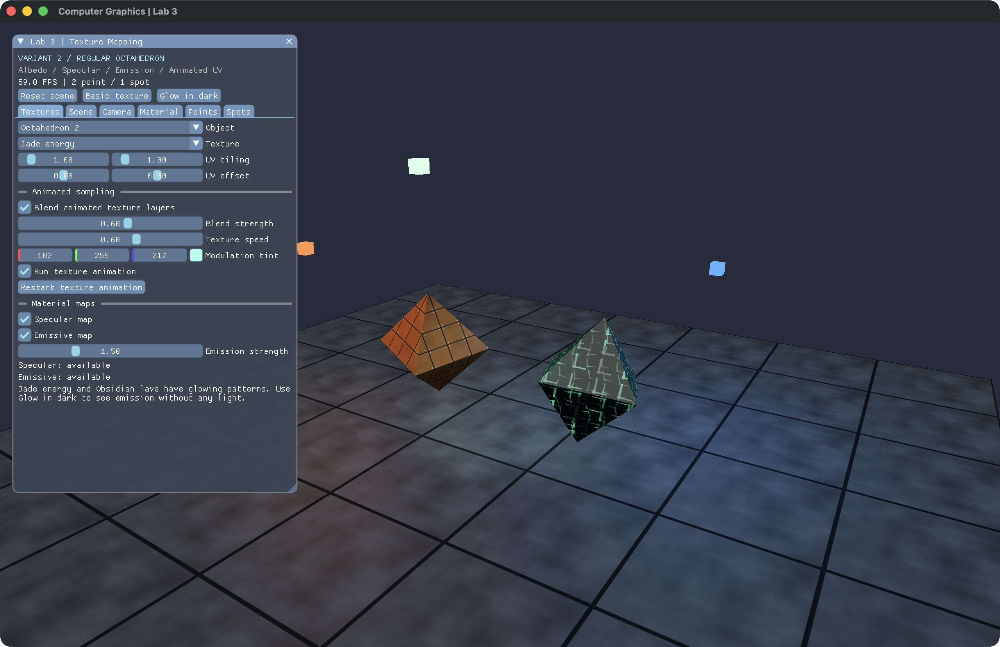

# Лабораторная работа №3: текстурирование

**Вариант 2 — правильный октаэдр.** Выполнены базовое задание и все три дополнительных задания, включая specular/emissive для оценки 5. Основа — камера, освещение Блинна–Фонга и сцена второй работы.



## Сборка и запуск

Из корня `computer_graphics`:

```bash
source "$HOME/VulkanSDK/1.4.321.0/setup-env.sh" # укажите установленную версию SDK
cmake --preset debug
cmake --build build-debug --parallel
./build-debug/lab3
```

Нужны CMake, компилятор C++20, Vulkan SDK с `glslc` и платформенные зависимости GLFW; подробнее — [корневой README](../../README.md). Пресеты release/MSVC/MinGW общие для всех работ. Шейдеры и текстуры ищутся по путям, заданным CMake, поэтому текущий рабочий каталог при запуске не важен. После перемещения исходников пересоздайте каталог сборки.

## Что демонстрируется

В сцене два октаэдра и текстурированный пол. Первый октаэдр покрыт медными плитками с выборочным блеском. На втором — светящиеся нефритовые дорожки и анимированное многократное сэмплирование. Пол использует повторяющийся сланцевый материал.

Во вкладке **Textures** выберите объект в списке **Object**, затем материал в **Texture**. Один материал можно назначить нескольким объектам: положения и свойства моделей сохраняются независимыми. Доступны масштаб и смещение UV, включение анимированных слоёв, их скорость, сила смешивания и цветовая модуляция. Отрицательная скорость обращает направление движения. **Run texture animation** останавливает время без скачка фазы; **Restart texture animation** обнуляет его.

**Specular map**, **Emissive map** и **Emission strength** управляют картами и интенсивностью свечения отдельно для каждого объекта. Вкладка **Material** позволяет менять оттенок альбедо, цвет блика, shininess и преобразования объектов. **Scene**, **Camera**, **Points**, **Spots** сохраняют настройки камеры и освещения второй работы.

| Кнопка | Результат |
| --- | --- |
| Reset scene | Исходная сцена с разными материалами |
| Basic texture | Одна общая текстура, без блеска, свечения и анимированного сэмплирования |
| Glow in dark | Нефрит и лава при полностью выключенных источниках и ambient |

Управление камерой: W/A/S/D, Q/E, Shift для ускорения; удерживание правой кнопки мыши для поворота; колесо для FOV; R для сброса; Tab для скрытия панели. Ввод учитывает захват клавиатуры и мыши интерфейсом ImGui.

## Соответствие заданию

| Требование PDF | Реализация |
| --- | --- |
| Vulkan, GLFW, ImGui, объекты предыдущей работы | Отдельная цель `lab3`, общий backend и сцена из lab2 |
| Изображения из файлов, сторонний декодер | PNG в `textures/`, `stbi_load()` в `source/image.cpp`; vendored stb_image с лицензией |
| Позиция, нормаль, UV в вершине | `Vertex` размером 32 байта, UV генерируются вместе с геометрией |
| Вершинные и индексные данные в VRAM | Device-local буферы, staging, `vkCmdCopyBuffer`, барьер transfer → vertex input, `vkCmdDrawIndexed` |
| Один динамический UBO для моделей | Общий массив `ModelUniform`, выравнивание по `minUniformBufferOffsetAlignment`, dynamic offset в `vkCmdBindDescriptorSets` |
| №1: выбор нескольких текстур для каждого объекта | Пять материалов и отдельный набор дескрипторов на материал; выпадающие списки Object/Texture |
| №2: нетривиальное сэмплирование | Два чтения одного изображения с различными UV, сдвиг, поворот, синусоидальная деформация, смешивание и модуляция от времени |
| №2: управление через push constants | 64-байтный `SamplingPush`; параметры эффектов не добавляются в `ModelUniform` |
| №3: specular/emissive | Три combined image sampler в материале; specular управляет бликом, emissive добавляется после Блинна–Фонга |
| №3: чёрный пиксель при отсутствии карты | Общая загруженная из `black.png` текстура 1×1 для отсутствующих specular/emissive |

Кнопка Basic texture показывает базовую часть в полной программе с дополнительными заданиями: флаги эффектов обнуляются. Push constants в этой версии используются для параметров текстурных эффектов; матрицы и свойства материала находятся в динамическом UBO. Небольшие кубики и направляющие источников используют прежний вспомогательный unlit pipeline.

## Vulkan: дескрипторы и память

```text
set 0 — сцена
  binding 0: UNIFORM_BUFFER          SceneUniform
  binding 1: STORAGE_BUFFER         PointGPU[]
  binding 2: STORAGE_BUFFER         SpotGPU[]

set 1 — материал (пять наборов)
  binding 0: UNIFORM_BUFFER_DYNAMIC  один общий model_buffer
  binding 1: COMBINED_IMAGE_SAMPLER  albedo
  binding 2: COMBINED_IMAGE_SAMPLER  specular или black
  binding 3: COMBINED_IMAGE_SAMPLER  emissive или black

fragment push constants, 64 байта
  uvec4 flags       animated, specular, emissive, reserved
  vec4 animation    time, strength, speed, emission intensity
  vec4 uvTransform  tiling.xy, offset.xy
  vec4 tint         modulation color
```

Для объекта `i` применяется `dynamicOffset = i × stride`, где `stride` — размер `ModelUniform` (160 байт), округлённый вверх до `minUniformBufferOffsetAlignment`. У всех материалов один и тот же model buffer. Дескриптор имеет `range = sizeof(ModelUniform)`, чтобы ненулевой dynamic offset не выходил за границу буфера. Матрица нормалей — обратная транспонированная матрица модели.

Текстуры используют optimal tiling и device-local память. Загрузка: CPU RGBA → host-visible staging → `vkCmdCopyBufferToImage`; переходы `UNDEFINED → TRANSFER_DST_OPTIMAL → SHADER_READ_ONLY_OPTIMAL`. Staging освобождается после ожидания fence. Альбедо и emissive загружаются как sRGB, specular как линейные UNORM данные. Общий sampler использует repeat и линейную фильтрацию; текстуры имеют один mip-уровень.

Геометрия октаэдров, пола и кубиков хранится в отдельных device-local vertex/index buffers без CPU mapping. Даже динамические линии конусов копируются из staging в device-local vertex buffer до render pass. Обновление динамического UBO, световых буферов и staging выполняется после ожидания fence предыдущего кадра в `prepare()`.

На Apple Silicon физическая память общая для CPU/GPU; код всё равно явно требует `DEVICE_LOCAL`, использует staging и команды копирования, как и на дискретной видеокарте.

## Текстуры и освещение

| Материал | Альбедо | Specular | Emissive |
| --- | --- | --- | --- |
| Copper tiles | Медные панели и заклёпки | Металл блестит, швы почти матовые | Чёрный пиксель |
| Jade energy | Нефритовые дорожки | Дорожки блестят сильнее подложки | Зелёные дорожки с шумовой модуляцией |
| Obsidian lava | Тёмный камень и трещины | Камень и трещины имеют разный блеск | Оранжевые трещины из шума Перлина |
| Ceramic checker | Контрастная шахматная сетка | Чёрный пиксель | Чёрный пиксель |
| Slate floor | Плитки сланца | Умеренный блеск, матовые швы | Чёрный пиксель |

Текстуры оригинальные, свободные для использования (CC0). Их создаёт [tools/generate_textures.py](tools/generate_textures.py) стандартной библиотекой Python: периодический градиентный шум Перлина, несколько октав и геометрические маски. Программа загружает готовые PNG с диска при запуске; генератор не является runtime-заменой загрузки файлов. Чтобы пересоздать изображения:

```bash
python3 labs/lab3/tools/generate_textures.py
```

После получения UV и текстурных значений шейдер считает:

```text
albedo   = sample(albedoMap, UV) × material.albedoTint
specular = sample(specularMap, UV) × material.specularColor
emission = sample(emissiveMap, UV) × emissionStrength
color    = ambient(albedo) + BlinnPhong(albedo, specular) + emission
output   = color / (1 + color)
```

Последняя строка — простое тональное отображение для сохранения рисунка при ярком свете. Specular влияет только на блик, emissive не зависит от света, угла обзора или нормали. Чёрный пиксель даёт ноль при умножении на цвет блика и при сложении свечения, поэтому отсутствующие карты не создают эффект.

При включённой анимации один и тот же sampler читается с двух разных, меняющихся во времени UV; результаты смешиваются. Цвет альбедо дополнительно модулируется выбранным оттенком и синусоидой времени. Specular и emissive используют те же координаты и вес смешивания, чтобы рисунки карт оставались согласованными.

## Проверка и демонстрация

```bash
ctest --test-dir build-debug --output-on-failure
./build-debug/lab3 --frames 15
VK_LAYER_ENABLES=VK_VALIDATION_FEATURE_ENABLE_SYNCHRONIZATION_VALIDATION_EXT ./build-debug/lab3 --exercise
```

CPU-тесты проверяют индексы, нормали и UV всех мешей, выравнивание и границы dynamic offsets, GPU layout, push constants, загрузку всех PNG, точное значение чёрного fallback, ошибки отсутствующего/повреждённого файла, камеру и освещение.

`--exercise` выполняет 110 кадров и автоматически закрывает окно: один общий материал → разные карты с анимацией → рост световых буферов и staging конусов → общий descriptor set при разных dynamic offsets → неравномерный масштаб и крайние UV → свечение без освещения → оставшиеся материалы → чёрные fallback-карты и пауза времени → сброс. Окно дважды меняет размер. Vulkan validation errors приводят к ненулевому коду завершения.

Проверено на macOS/MoltenVK с Vulkan SDK 1.4.321.0: сборки Debug и Release, оба набора CPU-тестов, 110 кадров lab3 с synchronization validation без ошибок и запуск Release из стороннего рабочего каталога. Дополнительно проверены запуск lab1 и полный `--exercise` lab2 после изменения общего main loop. Превью выше снято с работающего окна lab3.

Для защиты работы:

1. Нажать Basic texture и показать одну текстуру на всех объектах.
2. Назначить разным объектам Copper tiles, Jade energy, Obsidian lava и Ceramic checker. Показать, что положения не меняются при использовании общего материала.
3. На одном объекте включить Blend animated texture layers, изменить скорость, цвет и силу смешивания; остановить и возобновить время.
4. Перемещая камеру, показать блик на Copper tiles. Выключить Specular map и сравнить. У Ceramic checker карты нет, блик отсутствует.
5. Нажать Glow in dark. Выключить Emissive map у одного октаэдра: он исчезнет в темноте, второй продолжит светиться. Изменить Emission strength.

## Файлы

- `source/scene.*`: камера, геометрия с индексами/UV, материалы и GPU-структуры.
- `source/image.*`: декодирование изображений через stb_image.
- `source/renderer.cpp`: staging, device-local ресурсы, динамический UBO, дескрипторы и pipelines.
- `source/application.cpp`: интерфейс, управление и проверочный сценарий.
- `shaders/lit.*`, `shaders/scene.glsl`: текстурирование и Блинн–Фонг.
- `textures/`, `tools/generate_textures.py`: готовые PNG и воспроизводимый генератор.
- `tests/scene_tests.cpp`: CPU-проверки.

## Источники

- [Khronos: Images](https://docs.vulkan.org/tutorial/latest/06_Texture_mapping/00_Images.html) — staging и переходы layouts текстур.
- [Khronos: Staging buffer](https://docs.vulkan.org/tutorial/latest/04_Vertex_buffers/02_Staging_buffer.html) — копирование геометрии в device-local память.
- [Khronos: Descriptor Dynamic Offset](https://docs.vulkan.org/guide/latest/descriptor_dynamic_offset.html) — dynamic offsets, range и ограничения выравнивания.
- [stb_image, закреплённая версия](https://github.com/nothings/stb/blob/013ac3beddff3dbffafd5177e7972067cd2b5083/stb_image.h) — декодирование PNG; лицензия включена в заголовок.
